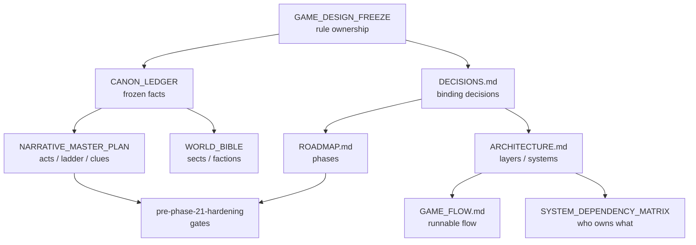

# Aetheria Knowledge Hub

> **This page is a map, not an authority.** Every section links to the document
> that actually owns the rule. If this page and its target disagree, the target
> wins (L-014) — and the disagreement itself is a bug to report.
>
> **Status legend:** `EXISTING CANON` (frozen) · `ACCEPTED DECISION` (in
> `docs/DECISIONS.md`) · `PROPOSAL` (awaiting owner review — not canon) ·
> `OPEN QUESTION` (undecided) · `HISTORICAL` (superseded or completed context).

Open this repository root as an Obsidian vault: full-text search, backlinks, and
the graph view then work over the same tracked Markdown — no second copy.
See [OBSIDIAN_SETUP.md](OBSIDIAN_SETUP.md).

---

## A. Authority and canon

**Who owns which rule** — the binding table lives in
[GAME_DESIGN_FREEZE.md](../GAME_DESIGN_FREEZE.md) (v2.1, frozen D-039).
Reference it; do not maintain a competing table.

| Start here | Owns |
|---|---|
| [CANON_LEDGER.md](../CANON_LEDGER.md) | Frozen facts: names, hierarchies, ids, world laws (cite `CL-nn`) |
| [WORLD_BIBLE.md](../WORLD_BIBLE.md) | Cosmology, geography, factions, Thiên Khế, historical Tà Đế |
| [NARRATIVE_MASTER_PLAN.md](../NARRATIVE_MASTER_PLAN.md) | Premise, prologue, Origins, ten acts, reveal ladder, clue ledger (§9a), state split (§14) |
| [CONTRADICTION_REGISTER.md](../CONTRADICTION_REGISTER.md) | Known contradictions + resolutions (cite `C-nnn`) |
| [GAME_DESIGN_FREEZE.md](../GAME_DESIGN_FREEZE.md) | What "frozen" means, change control, the 13 frozen documents |
| [DECISIONS.md](../DECISIONS.md) | Every binding decision — see the [decision index](DECISION_INDEX.md) |

**Current statuses (2026-10-12):**
- `ACCEPTED DECISION` **D-074**: online multiplayer-first, server-authoritative
  production world; Admin Offline Test Mode secondary. (Tension with the frozen
  "Offline is the source of truth" line is **Q-08**, open.)
- `PROPOSAL` **C2 saga/sect proposal** —
  [PROPOSAL_SAGA_SECT_ATLAS_CULTIVATION_AND_P21_HANDOFF.md](../proposals/PROPOSAL_SAGA_SECT_ATLAS_CULTIVATION_AND_P21_HANDOFF.md)
  — **NOT CANON, owner review required.**
- `PROPOSAL` **C1 proposals** (shared-world story model, online authority
  architecture) — not frozen, not authority.
- `OPEN QUESTION` **Q-02**: world-chronicle scope (per-shard vs per-group) — undecided.
- `OPEN` **H21-14**: owner playtest required before Phase 21.

---

## B. Architecture and connected systems

High-level map with evidence-backed relationships. The full edge list with
rationales is in [DOCS_DEPENDENCY_MAP.md](DOCS_DEPENDENCY_MAP.md) —
edges there cite their source; related-topic links are not dependencies.

- **Layers** (strict, downward only): `presentation → gameplay → domain → data`
  — owner: [.kiro/steering/03-architecture.md](../../.kiro/steering/03-architecture.md),
  [ARCHITECTURE.md](../ARCHITECTURE.md)
- **State ownership**: one owner per state; persistent / runtime / presentation
  tiers — owner: [SYSTEM_DEPENDENCY_MATRIX.md](../SYSTEM_DEPENDENCY_MATRIX.md)
- **Game flow**: the runnable flow + per-system contracts —
  owner: [GAME_FLOW.md](../GAME_FLOW.md)
- **Access gating** (never level-gated, C-002): layered gates (realm + quest +
  knowledge + standing + world state + key item) —
  owner: [MAP_DUNGEON_DESIGN.md](../MAP_DUNGEON_DESIGN.md) §3
- **Multiplayer target** (D-056, authoritative dedicated server — target, not
  implementation): [PRODUCTION_ARCHITECTURE_CONTRACT.md](../PRODUCTION_ARCHITECTURE_CONTRACT.md) ·
  seams: [MULTIPLAYER_PLAN.md](../MULTIPLAYER_PLAN.md)
- **Data shapes / damage formula**: [DATA_SCHEMA.md](../DATA_SCHEMA.md) ·
  **Save format**: [SAVE_FORMAT.md](../SAVE_FORMAT.md)

Mermaid overview (highest level only; details in the dependency map):

---

## C. Decisions

The authoritative log is [docs/DECISIONS.md](../DECISIONS.md).
Browse it by ID, title, and status in the **generated**
[DECISION_INDEX.md](DECISION_INDEX.md) (regenerate:
`python3 tools/gen_decision_index.py`; the validator checks it is current).

Status vocabulary as actually used: `Accepted` · `Open` · `SUPERSEDED` ·
`DONE` · `ADOPTED` · free text · `Not recorded` (never inferred as Accepted).

---

## D. Open items, gates, and phase status

Authoritative sources — the hub does not keep a parallel status register:

- **Hardening gates**: [pre-phase-21-hardening.md](../handoff/pre-phase-21-hardening.md)
  §18.5 — H21-14 **OPEN / OWNER REQUIRED** · H21-21 CLOSED · H21-20 CLOSED ·
  B2-01 / UI-01 / UI-02 OPEN (non-blocking)
- **Phase status**: [ROADMAP.md](../ROADMAP.md) — Phase 20 DONE ·
  **Phase 21 / 22 NOT STARTED** · multiplayer phases 32–34
- **Contradictions**: [CONTRADICTION_REGISTER.md](../CONTRADICTION_REGISTER.md)
- **Open design questions**: C2 proposal §19 (Q-01…Q-09) — `PROPOSAL`, not gates
- **Owner actions pending**: H21-14 playtest (§17.6) · Q-01 kept/told definitions ·
  Q-08 freeze amendment

---

## E. Proposals and historical context

Proposals are **not** accepted design. Never cite one as authority.

- [C2: saga, sect atlas, cultivation loop & P21/22 handoff](../proposals/PROPOSAL_SAGA_SECT_ATLAS_CULTIVATION_AND_P21_HANDOFF.md) — PROPOSAL — NOT CANON
- [C1: shared-world story model](../proposals/PROPOSAL_SHARED_WORLD_STORY_MODEL.md) — PROPOSAL — NOT FROZEN
- [C1: online authority architecture](../proposals/PROPOSAL_ONLINE_AUTHORITY_ARCHITECTURE.md) — PROPOSAL — NOT FROZEN
- Phase handoffs: [docs/handoff/](../handoff/) (historical evidence per phase)

---

## F. Practical entry points

- **Before changing a system** → read its owner doc (table in §A), then
  [DOCS_DEPENDENCY_MAP.md](DOCS_DEPENDENCY_MAP.md) for downstream docs, then run
  the [sync contract](DOCS_SYNC_CONTRACT.md).
- **Before making a design decision** → check [DECISION_INDEX.md](DECISION_INDEX.md)
  for prior art; a binding change needs a `DECISIONS.md` entry (freeze change control).
- **Before editing narrative or canon** → [NARRATIVE_MASTER_PLAN.md](../NARRATIVE_MASTER_PLAN.md)
  + [CANON_LEDGER.md](../CANON_LEDGER.md); canon changes require a decision entry.
- **Before changing save/data schemas** → [SAVE_FORMAT.md](../SAVE_FORMAT.md) +
  [DATA_SCHEMA.md](../DATA_SCHEMA.md); check the dependency map for consumers.
- **Before changing anything a player will see** (map area, landmark, panel, character
  presentation, motion) → [VISUAL_CRAFT_WORKFLOW.md](../VISUAL_CRAFT_WORKFLOW.md): the
  one-page Visual Design Brief, then the owners it links to.
- **Before changing a public method, signal, state owner or data id** →
  [GDSCRIPT_CODE_INTELLIGENCE.md](../GDSCRIPT_CODE_INTELLIGENCE.md): real callers from Godot's
  own language server (GodotLens), data/locale references from `tools/code_intel.py`.
- **Before starting a new phase** → [ROADMAP.md](../ROADMAP.md) (exit criteria) +
  [PHASE_EXECUTION_PROTOCOL.md](../PHASE_EXECUTION_PROTOCOL.md) (the 13-gate chain).
- **Before reviewing a proposal** → confirm its status label; proposals never
  overrule canon or accepted decisions.
- **When documents contradict** → owner wins; log it per [CONTRADICTION_REGISTER.md](../CONTRADICTION_REGISTER.md)
  conventions — do not silently pick a side (L-014).

---

## Maintenance

- This page: hand-maintained, links verified by `python3 tools/validate_docs.py`.
- [DECISION_INDEX.md](DECISION_INDEX.md): generated — never edit by hand.
- [DOCS_DEPENDENCY_MAP.md](DOCS_DEPENDENCY_MAP.md): hand-maintained; every edge
  cites evidence. Add an edge only when a real dependency is verified.
- Change process for any edit: [DOCS_SYNC_CONTRACT.md](DOCS_SYNC_CONTRACT.md).
- Audit trail: [AUDIT_REPORT.md](AUDIT_REPORT.md).
